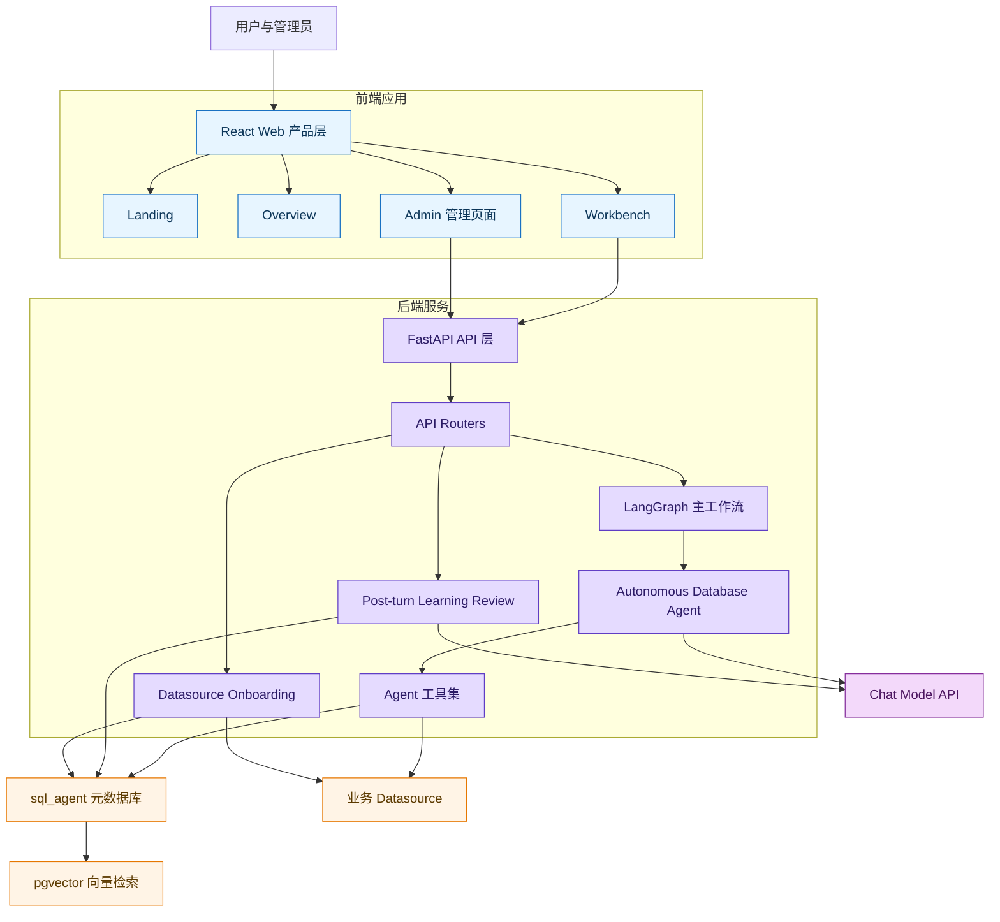
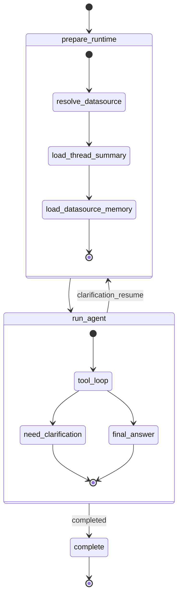
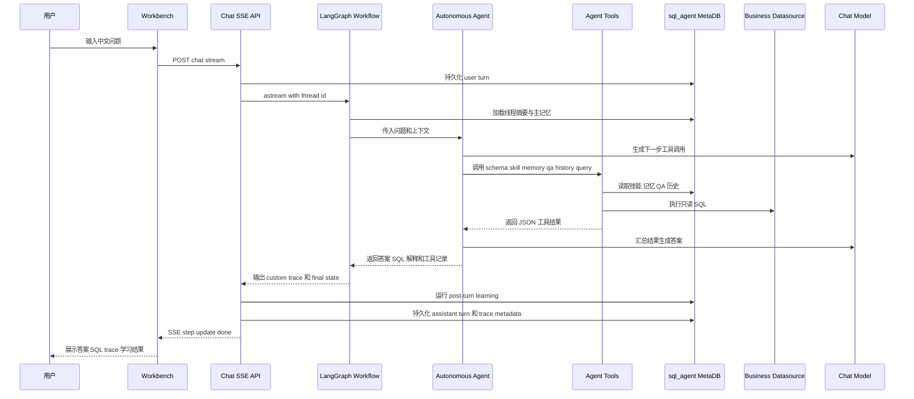
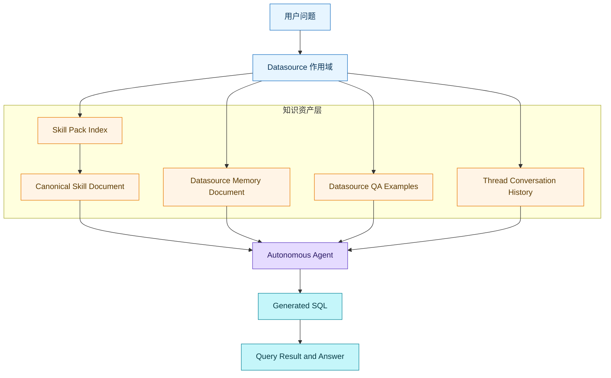
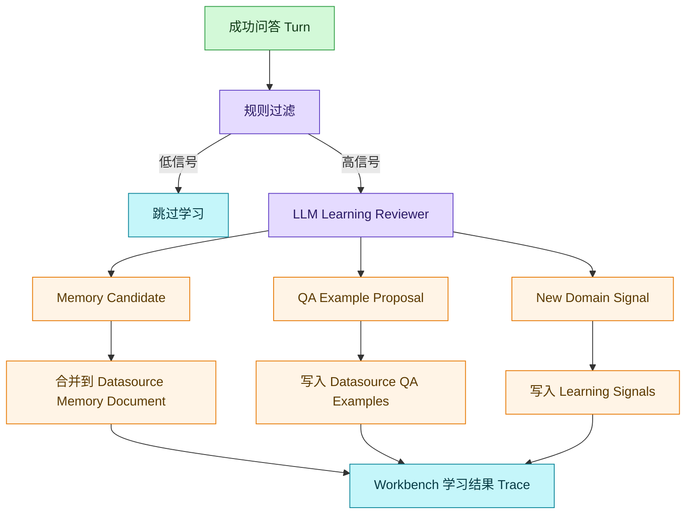
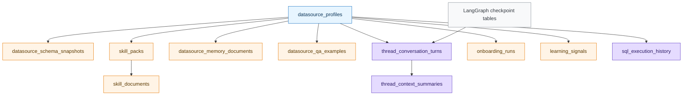

# SQL Genius 系统设计文档

> [!abstract]
> `SQL Genius` 是一个面向毕业设计的智能 Text-to-SQL 系统。当前版本采用 `FastAPI + LangGraph + LangChain + PostgreSQL + React` 技术栈，以 datasource 为核心组织 schema、技能、记忆、历史与问答案例，通过自主数据库 Agent 完成 SQL 生成、执行、解释和运行后学习。

## 1. 文档定位

本文档描述当前代码仓库中的系统设计，而不是未来设想或历史迁移记录。它用于：

- 解释系统为什么采用 datasource-centered 架构。
- 说明后端、前端、数据库和 Agent 运行时如何协作。
- 梳理 Skills、Memory、QA、History 等知识资产的边界。
- 为论文、答辩和后续维护提供一份完整的架构说明。

相关阅读：

- [[README]]
- [[AGENTS]]
- [[docs/current-system-explainer]]
- [[docs/agent-architecture-reference]]
- [[docs/skill-studio-rollout]]
- [[docs/lab-databases-overview]]

> [!info]
> 当前产品名在代码与文档中统一按 `SQL Genius` 理解。仓库路径中仍可能出现 `sql-agent-plus`，它是项目目录名，不影响系统设计语义。

## 2. 设计目标

系统的核心目标不是只把自然语言转换成一条 SQL，而是构建一个可解释、可观察、可持续学习的数据库问答 Agent。

### 2.1 功能目标

- 支持用户围绕一个选定 datasource 提出中文业务问题。
- 自动理解表结构、字段含义、业务技能、历史经验和相似 QA。
- 在安全约束下生成并执行只读 SQL。
- 通过 SSE 向前端持续输出可观察 trace。
- 支持问题模糊时的人类澄清与 LangGraph resume。
- 在成功问答后自动沉淀主记忆和 QA 案例。
- 为管理员提供 Datasources、Skills、Memory、Q&A、History 等观察与治理页面。

### 2.2 非目标

- 不做任意写库操作，业务 datasource 查询默认只允许 `SELECT`。
- 不把运行时学习理解为训练大模型；系统学习的是可检索资产。
- 不再维护旧的 domain / knowledge / sql_rule 路由模型。
- 不把所有知识混入一个大 prompt；不同资产按职责分层管理。

### 2.3 设计原则

| 原则 | 说明 |
|---|---|
| Datasource-centered | 每个 datasource 拥有独立 schema、技能、记忆、历史和 QA，避免跨库污染。 |
| Single workflow | 主聊天路径保持一个 LangGraph 工作流，内部节点可以承载自主 Agent。 |
| Tool-loop first | Agent 通过工具循环自主决定何时查 schema、读技能、搜 QA、执行 SQL。 |
| Observable by default | 前端展示产品化 trace，而不是只显示最终答案。 |
| Learning after use | 成功回答后再沉淀资产，避免 onboarding 阶段预造低质量案例。 |
| Safety over novelty | 答辩优先稳定、可演示、可解释，不追求过度复杂的新架构。 |

## 3. 总体架构

系统由四层组成：

- 前端产品层：React 工作台和管理后台。
- 后端编排层：FastAPI API、LangGraph 工作流、自主 Agent、学习回顾。
- 元数据层：PostgreSQL `sql_agent` 数据库，保存配置、技能、记忆、历史、QA、checkpoint。
- 业务数据层：多个 datasource，例如三个 lab PostgreSQL 数据库。



> [!tip]
> 答辩时可以把系统概括为：一个 datasource 作用域内的自主数据库 Agent，利用 schema、技能、主记忆、历史和 QA 示例进行可观察的 SQL 推理，并在成功运行后继续沉淀可复用资产。

## 4. 技术栈

| 层级 | 技术 | 作用 |
|---|---|---|
| 前端 | React 19、Vite、TypeScript、Tailwind v4、shadcn/ui | 产品工作台与管理后台 |
| 后端 API | FastAPI、Pydantic | HTTP API、SSE 流、结构化请求响应 |
| Agent 编排 | LangGraph、LangChain | 单工作流、checkpoint、tool calling |
| 数据访问 | SQLAlchemy 2.0、Alembic | ORM、迁移、元数据库访问 |
| 元数据库 | PostgreSQL 18、pgvector | 平台资产、向量检索、LangGraph checkpoint |
| 业务库 | PostgreSQL / MySQL 兼容设计 | 被查询的 datasource |
| 工具链 | uv、uvicorn、docker compose | 本地开发与演示启动 |

## 5. 后端设计

### 5.1 FastAPI 应用入口

后端入口位于 `backend/app/main.py`。应用通过 `create_app()` 创建 FastAPI 实例，并在 lifespan 中初始化 LangGraph workflow。

关键行为：

- 正常模式使用 `AsyncPostgresSaver` 作为 LangGraph checkpoint 存储。
- 测试或跳过 DB lifespan 时使用 `MemorySaver`。
- 启动时执行一次 `SELECT 1` 检查元数据库连接。
- 注册 health、chat、execution、admin datasources、admin history、admin learning、admin skill packs 等路由。

### 5.2 API 分层

| 路由模块 | 职责 |
|---|---|
| `chat.py` | SSE 聊天流、LangGraph 调用、interrupt/resume、turn 持久化、post-turn learning |
| `execution.py` | SQL 执行相关接口，受只读安全约束保护 |
| `admin_datasources.py` | 数据源注册、结构采集、onboarding、分析 run |
| `admin_skill_packs.py` | 技能包与 canonical skill document 管理 |
| `admin_learning.py` | Memory、Q&A、线程摘要等学习资产观察接口 |
| `admin_history.py` | Workbench 历史会话与 datasource 分析工作区 |
| `health.py` | 服务健康检查 |

### 5.3 LangGraph 主工作流

主工作流位于 `backend/app/workflow/graph.py`，保持三段式结构：



各节点职责：

| 节点 | 职责 |
|---|---|
| `prepare_runtime` | 解析 datasource，加载线程摘要，召回 datasource memory，写出准备阶段 trace |
| `run_agent` | 调用 `run_autonomous_agent()`，执行 LLM + Tool Loop，必要时触发 clarification interrupt |
| `complete` | 汇总完成状态、SQL 是否生成、记忆命中标题等信息 |

## 6. 自主数据库 Agent 设计

### 6.1 Agent 运行时

核心实现位于 `backend/app/services/autonomous_agent.py`。它借鉴 deepagents 与 hermes-agent 的思想，但不是直接依赖这些项目。

运行时特点：

- 使用 `ChatOpenAI` 兼容接口调用外部模型。
- 使用 LangChain tool calling 暴露数据库工具。
- 默认最大工具循环步数为 `15`。
- 在系统 prompt 中注入 schema 概览、技能目录、主记忆、线程摘要和近期对话。
- 对复杂问题优先读取技能主文档和 QA 示例，再考虑历史对话。
- 工具结果以 JSON 字符串返回，错误作为数据返回，减少异常中断。

### 6.2 Agent 工具面

工具构造位于 `backend/app/services/agent_tools.py`。

| 工具 | 作用 | 设计要点 |
|---|---|---|
| `introspect_schema` | 查看表、字段、类型、注释与约束 | 默认返回表摘要，指定表名返回完整结构 |
| `execute_query` | 执行只读 SQL 并返回真实结果 | 使用 `SqlSafetyService.validate`，结果最多保留 50 行 |
| `search_skills` | 搜索当前 datasource 的技能包索引 | 优先向量检索，回退到普通查询 |
| `search_skill_documents` | 读取技能 canonical Markdown 文档 | QA 示例不混入技能正文 |
| `search_qa_examples` | 检索运行时沉淀的相似问答案例 | 为 SQL 模式提供参考，不替代业务规则 |
| `recall_memory` | 检索 datasource 主记忆中的相关条目 | 只召回稳定长期知识 |
| `search_history` | 搜索历史对话和过往 SQL | 作为技能和 QA 不足时的兜底 |
| `save_memory` | 写入极少量长期稳定知识 | 直接并入 Agent-maintained memory document |

### 6.3 上下文注入策略

Agent 的初始上下文包含：

- 当前 datasource 的 schema overview，包含表名、字段名和字段注释摘要。
- 可用技能目录，包含 skill id、名称、摘要、表焦点和关键词。
- `prepare_runtime` 召回的 datasource memory。
- 滚动线程摘要和近期对话。
- 用户当前问题。

这种策略解决两个问题：

- Agent 不必完全依赖主动 `search_skills` 才知道有哪些技能。
- 长对话不会无限堆叠，而是通过 thread summary 压缩旧上下文。

## 7. 在线问答流程



### 7.1 SSE 可观察事件

`chat.py` 将 LangGraph 输出转换成前端可消费的 SSE：

- `step`：产品化 trace，包括准备上下文、工具调用、工具结果、SQL 进度、学习结果。
- `update`：LangGraph 节点状态更新。
- `interrupt`：需要用户澄清时返回中断 payload。
- `done`：本轮完成，包含 assistant turn id 等信息。
- `error`：异常时返回简短错误消息。

> [!warning]
> Workbench trace 是产品化可观察层，不是模型私有 chain-of-thought。它只展示工具行为、关键参数、结果摘要和学习产物。

### 7.2 澄清与 resume

当 Agent 判断用户问题缺少必要信息时，`run_agent` 节点通过 LangGraph `interrupt()` 返回澄清问题。前端把用户补充内容作为 `resume` 请求提交，工作流重新进入 `prepare_runtime`，将原问题与澄清内容合并后继续执行。

## 8. 知识资产分层

当前系统明确区分 Skills、Memory、QA、History 四类资产。



| 资产 | 存什么 | 不存什么 | 主要用途 |
|---|---|---|---|
| Skills | 业务方法、指标口径、关键表关系、易错点 | 零散历史结果、一次性问答日志 | 让 Agent 理解某类问题的业务方法 |
| Memory | 长期稳定事实、全局查询注意事项 | SQL 示例、临时结果、单次结论 | 作为 datasource 的稳定背景知识 |
| QA | 真实运行沉淀的问题、SQL、说明、场景标签 | onboarding 预造模板、技能正文 | 为相似问题提供 SQL 模式参考 |
| History | 对话 turn、生成 SQL、trace metadata | 长期知识 source of truth | 恢复历史会话和兜底检索 |

> [!important]
> SQL 示例属于独立 QA 层，不写入 datasource memory，也不作为 canonical skill document 的主要内容。这样可以避免技能文档膨胀，也避免主记忆被案例日志污染。

## 9. 运行后学习设计

运行后学习由 `backend/app/services/learning_review.py` 负责，并在 `chat.py` 的 SSE 主流程中、`done` 事件之前执行。这样用户可以在同一轮回答中看到学习结果。

### 9.1 触发条件

学习回顾先通过轻量规则过滤，避免每轮都调用 LLM：

- 正向用户反馈会触发学习。
- 成功执行复杂 SQL 会触发学习。
- 复杂 SQL 判断包含 `JOIN`、`GROUP BY`、`HAVING`、`UNION`、`WITH`、`CASE WHEN`、`EXISTS` 等模式。
- 失败 SQL、无 SQL、低信号问题默认不沉淀。

QA 候选还需要通过：

- 问题长度达到最低要求。
- SQL 执行成功。
- SQL 具备复杂度。
- 问法不是明显低价值的“看一下”“查一下”等泛化指令。

### 9.2 学习产物



学习结果分为：

- `memory_candidates`：高置信、长期稳定事实，直接合并到 datasource memory document。
- `skill_enrichments`：目前优先作为结构化 QA 示例写入 QA 层。
- `new_domain_signal`：当问题明显不属于已有技能覆盖范围时，写入 learning signals。

### 9.3 主记忆合并策略

主记忆是每个 datasource 一份 Agent-maintained Markdown document。写入时强调：

- 标题稳定，方便替换旧结论。
- 内容短，避免把 SQL 或长问答塞进主记忆。
- 同标题更新会替换旧结论，减少长期膨胀。
- 管理员在 `Admin / Memory` 观察，不直接手工维护。

## 10. Datasource Onboarding 设计

Datasource onboarding 负责把一个外部数据库变成可被 Agent 稳定使用的 datasource。

```mermaid
graph LR
    Input["连接信息"] --> Normalize["URL 标准化"]
    Normalize --> Register["注册 Datasource Profile"]
    Register --> Introspect["结构采集"]
    Introspect --> Snapshot["保存 Schema Snapshot"]
    Snapshot --> AnalysisRun["创建 Onboarding Run"]
    AnalysisRun --> LLMAnalyze["LLM 业务分析"]
    LLMAnalyze --> Skills["生成 Skill Packs"]
    Skills --> CanonicalDoc["生成 Canonical Documents"]
    CanonicalDoc --> Ready["Datasource Ready"]

    AnalysisRun -.-> Clarify["Run-scoped Clarification Chat"]
    Clarify -.-> LLMAnalyze

    classDef input fill:#d3f9d8,stroke:#2f9e44,color:#123b18
    classDef process fill:#e5dbff,stroke:#5f3dc4,color:#2b1a65
    classDef store fill:#fff4e6,stroke:#e67700,color:#5c3a00
    classDef done fill:#c5f6fa,stroke:#0c8599,color:#073b45
    class Input input
    class Normalize,Register,Introspect,LLMAnalyze,Clarify process
    class Snapshot,AnalysisRun,Skills,CanonicalDoc store
    class Ready done
```



当前实现要点：

- 支持完整连接 URL，也支持 host、port、database、username、password 分字段输入。
- 结构采集保存到 `datasource_schema_snapshots`。
- PostgreSQL schema 采集包含表/字段注释，前端结构浏览会展示这些注释。
- onboarding 是后台 run，前端通过 `Admin / History` 的分析工作区观察进度。
- 不再使用启发式 fallback；LLM 分析失败时 datasource 状态为 `analysis_failed`。
- `./scripts/demo.sh up` 会自动确保三个 lab 数据库和 datasource 注册存在；如需同时触发 onboarding，可设置 `SQL_AGENT_DEMO_LABS_WITH_ONBOARDING=1`。

## 11. 元数据库设计

平台元数据库默认为 `sql_agent`。它保存系统资产、状态与运行历史，而三个 `lab_*` 数据库是被查询的业务数据库。

### 11.1 核心表族

| 表族 | 表 | 作用 |
|---|---|---|
| Datasource | `datasource_profiles`、`datasource_schema_snapshots` | 数据源配置、状态、schema 快照 |
| Skills | `skill_packs`、`skill_documents` | 技能索引和 canonical Markdown 文档 |
| Memory | `datasource_memory_documents` | 每个 datasource 一份主记忆文档 |
| QA | `datasource_qa_examples` | 自动沉淀的问题、SQL、note、场景标签 |
| Thread | `thread_conversation_turns`、`thread_context_summaries` | 对话 turn、trace metadata、滚动摘要 |
| Learning | `learning_signals` | 新领域信号等低频学习缓冲 |
| Admin | `admin_sessions`、`onboarding_runs`、`sql_execution_history` | 历史会话、分析 run、SQL 执行记录 |
| Infrastructure | `checkpoints`、`checkpoint_blobs`、`checkpoint_writes`、`alembic_version` | LangGraph checkpoint 与迁移版本 |

### 11.2 资产关系图



### 11.3 向量检索

系统使用 pgvector 支持：

- skill pack summary embedding。
- skill document embedding。
- datasource memory / QA example 的语义检索。

当 embedding 客户端不可用或 embedding 未就绪时，部分检索逻辑会回退到普通查询或关键词匹配，保证演示路径不因单点失败完全中断。

## 12. 前端设计

前端位于 `web/`，采用 React Router 管理页面。UI 目标是中文、克制、Apple-inspired、产品化，而不是传统后台系统风格。

### 12.1 页面结构

| 路由 | 页面 | 作用 |
|---|---|---|
| `/` | Landing | 产品入口 |
| `/overview` | Overview | 系统总览和答辩叙事入口 |
| `/workbench` | Workbench | 主问答工作台 |
| `/admin/datasources` | Admin Datasources | 数据源列表、导入、结构观察 |
| `/admin/datasources/new` | Datasource Wizard | 新数据源接入向导 |
| `/admin/datasources/:id` | Datasource Detail | 单数据源详情 |
| `/admin/skills` | Admin Skills | 技能包管理 |
| `/admin/skills/:packId` | Skill Detail | 技能索引和 canonical 文档编辑 |
| `/admin/memory` | Admin Memory | 主记忆观察 |
| `/admin/qa` | Admin Q&A | 自动沉淀问答案例 |
| `/admin/history` | Admin History | 数据源分析 workspace 和历史会话 |

### 12.2 Workbench 设计

Workbench 是演示核心页面，负责：

- datasource 选择和线程绑定。
- 用户输入与 assistant Markdown 回复。
- live assistant bubble。
- SQL 预览、格式化、高亮、复制。
- 查询执行结果表格。
- trace timeline，包括工具调用、记忆命中、SQL 生成、学习结果。
- 历史会话恢复与删除。
- 反馈按钮，用于触发或补充学习信号。

### 12.3 管理后台设计

管理后台不是传统 CRUD 后台，而是系统可解释性的展示层：

- `Admin / Datasources` 展示接入、结构、状态、分析 run。
- `Admin / Skills` 展示 datasource 下的技能资产。
- `Admin / Memory` 展示 Agent-maintained 主记忆，不提供人工编辑入口。
- `Admin / Q&A` 展示真实运行沉淀的 SQL 问答案例，并复用 SQL 格式化/高亮组件。
- `Admin / History` 支持 datasource onboarding 过程观察和历史线程查看。

## 13. SQL 安全设计

系统把 SQL 安全作为产品基础约束。

| 约束 | 实现 |
|---|---|
| 只读查询 | `SqlSafetyService.validate` 拒绝非 `SELECT` SQL |
| 业务 datasource 隔离 | 每个请求绑定 datasource id，同一 thread 禁止静默切换 datasource |
| 结果截断 | `execute_query` 返回最多 50 行，工具结果长文本会截断 |
| 错误数据化 | 工具异常以 JSON error 返回，避免 Agent 循环直接崩溃 |
| 管理面可观察 | SQL、解释、trace metadata 持久化，便于复盘 |

> [!danger]
> 当前系统不应该开放任意 DDL/DML 执行。即使模型生成了修改语句，也必须被安全层拒绝。

## 14. 部署与启动

### 14.1 Compose 服务

根目录 `docker-compose.yml` 定义三类服务：

| 服务 | 默认端口 | 说明 |
|---|---|---|
| `postgres` | `5432` | pgvector-enabled PostgreSQL 18 |
| `backend` | `8000` | FastAPI + LangGraph API |
| `web` | `3001` | Nginx 托管的前端构建产物 |

### 14.2 推荐启动命令

```bash
./scripts/demo.sh up
```

该命令会：

- 构建并启动 compose stack。
- 等待 API 和 Web UI 健康检查。
- 可选清理 Workbench 历史：`SQL_AGENT_DEMO_CLEAN_HISTORY=1`。
- 自动确保三个 lab 数据库存在并注册为 datasources。
- 默认跳过 lab onboarding；如需一起跑 onboarding，设置 `SQL_AGENT_DEMO_LABS_WITH_ONBOARDING=1`。

### 14.3 新机器初始化

推荐路径：

1. 配置 `.env` 中的数据库、chat model、embedding model 变量。
2. 执行 `./scripts/demo.sh up`。
3. 打开 `http://127.0.0.1:3001`。
4. 在管理页面对 datasource 触发 onboarding，生成技能包和主记忆。
5. 进入 Workbench 进行问答演示。

## 15. 演示数据设计

项目内置三个复杂 lab 数据库，由 `backend/provision_complex_postgres_labs.py` 生成：

| 数据库 | Datasource ID | 业务主题 |
|---|---|---|
| `lab_retail_analytics` | `lab-retail-docker` | 零售全渠道运营 |
| `lab_healthcare_claims` | `lab-healthcare-docker` | 医疗理赔风控 |
| `lab_manufacturing_iot` | `lab-manufacturing-docker` | 制造物联网质量 |

这些库用于覆盖不同复杂度：

- 多表 join 和指标口径。
- 时间序列和窗口统计。
- 异常检测、风险分层、库存和质量问题。
- 表/字段注释展示和 schema 语义增强。

> [!example]
> 推荐答辩演示顺序：先在 Overview 讲架构，再到 Workbench 问一个模糊问题触发澄清，然后问一个具体业务问题展示技能、记忆、QA、SQL、执行结果和运行后学习，最后切到 Admin 页面展示资产沉淀。

## 16. 可观测性设计

可观测性是本系统区别于普通 Text-to-SQL demo 的关键。

### 16.1 前端可观察内容

- Agent 当前阶段。
- 加载的线程摘要和主记忆标题。
- schema introspection。
- 技能目录和技能文档命中。
- QA 示例命中。
- SQL 生成与执行状态。
- post-turn learning 的 memory / QA / signal 结果。

### 16.2 后端可观察数据

- `thread_conversation_turns.turn_metadata.trace_steps` 保存 trace。
- `generated_sql`、`sql_explanation`、`sql_execution_success` 随 assistant turn 持久化。
- `tool_calls_made` 和 `activated_skill_pack_names` 用于学习回顾。
- `admin_sessions` 提供侧边栏会话历史。
- LangGraph checkpoint 表支持中断恢复。

## 17. 测试与验证

推荐验证命令：

```bash
cd backend && uv run pytest
cd web && npm run lint && npm run build
```

聚焦验证：

```bash
cd backend && uv run pytest \
  tests/api/test_chat_stream.py \
  tests/api/test_admin_datasources.py \
  tests/api/test_admin_skill_packs.py \
  tests/api/test_admin_learning.py \
  tests/services/test_thread_context.py \
  tests/services/test_learning_review.py
```

前端快速检查：

```bash
cd web && npx tsc --noEmit
```

重点测试面：

- chat SSE 流和 trace 事件。
- clarification interrupt / resume。
- datasource 线程绑定。
- SQL safety guard。
- datasource memory recall。
- post-turn learning review。
- QA example auto-sedimentation。
- admin pages 的数据读取和展示。

## 18. 扩展设计

### 18.1 新增 datasource 类型

新增数据库类型时应保持统一抽象：

- `datasource_profiles` 保存连接和 profile。
- `datasource_schema_snapshots` 保存结构快照。
- `resolve_datasource_url()` 负责运行时连接解析。
- schema introspection 服务适配不同方言。
- SQL safety 服务按方言逐步增强。

### 18.2 新增 Agent 工具

新增工具应遵守：

- 工具函数闭包捕获 `session`、`settings`、`datasource_id`。
- 返回 JSON 字符串。
- 错误作为结构化数据返回。
- 结果必须截断或摘要，避免撑爆上下文。
- 工具说明要明确何时使用、何时不用。

### 18.3 新增知识资产

新增资产前要先回答：

- 它是否属于 datasource 作用域。
- 它是否和 Skills、Memory、QA、History 已有职责重叠。
- 它是否会参与运行时检索。
- 它是否需要 embedding。
- 它是否需要前端可观察页面。

## 19. 当前边界与风险

| 风险 | 当前处理 | 后续方向 |
|---|---|---|
| LLM 分析失败 | onboarding 标记 `analysis_failed`，不生成低质量 fallback | 增加重试和诊断说明 |
| 记忆过度写入 | 学习 prompt 要求克制，主记忆按标题替换 | 用真实 traces 调 precision / recall |
| QA 过度沉淀 | 低信号问法和 SQL 复杂度过滤 | 增加去重和人工隐藏能力 |
| SQL 方言差异 | 当前以 PostgreSQL lab 为主，设计兼容 MySQL | 增强安全解析和方言格式化 |
| trace 过大 | `_truncate_trace_value` 控制 payload | 对大工具结果做更细粒度卸载 |
| embedding 不可用 | 部分逻辑回退普通查询 | 增加 UI 层 embedding 状态和重嵌入入口 |

## 20. 总结

`SQL Genius` 当前已经从一次性 SQL 生成器演进为 datasource-centered 的自主数据库 Agent 产品。它的核心价值不只在于生成 SQL，而在于：

- 能围绕一个 datasource 组织 schema、技能、记忆、QA 和历史。
- 能通过工具循环自主获取上下文、执行 SQL、解释结果。
- 能把执行过程产品化展示，支撑答辩中的可解释性。
- 能在成功运行后自动沉淀主记忆和 QA 示例，形成持续改进闭环。

一句话概括：

> [!quote]
> 这是一个以 datasource 为边界、以自主 Agent 为运行核心、以 Skills / Memory / QA 为知识资产层、以 Workbench trace 为可观察界面的 Text-to-SQL 系统。
